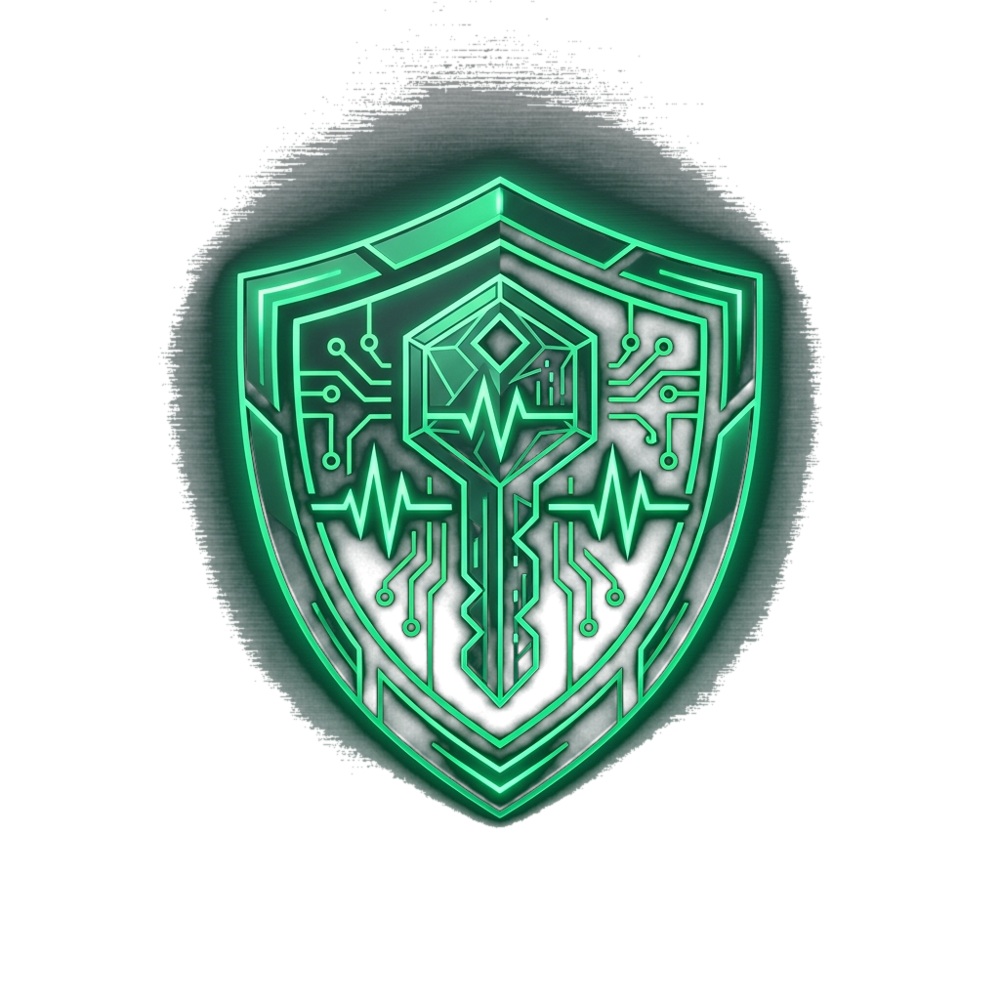

<div align="center">



# RYZ Authenticator

**Enterprise-Grade, No-Bloat, Zero-Knowledge Multi-Platform 2FA Authenticator**

[](https://github.com/riyazalsodie/RYZ-Authenticator/releases)
[](https://www.rust-lang.org/)
[](https://v2.tauri.app/)
[](https://react.dev/)
[]()
[]()

[Features](#-key-features) • [Security Model](#-zero-knowledge-security-architecture) • [Downloads](#-downloads--installers) • [Building from Source](#-building-from-source) • [CI/CD](#-automated-cloud-cicd)

</div>

---

## 📖 About RYZ Authenticator

**RYZ Authenticator** is a native, ultra-fast, and hardware-secured Two-Factor Authentication (2FA) client designed as a clean, no-bloat alternative to proprietary mobile-only authenticator apps.

Engineered on a **Rust core** paired with a sleek **Tauri 2.0 + React** frontend, RYZ Authenticator guarantees that your sensitive OTP seeds and secrets remain strictly under your control. It features hardware-bound anti-theft session persistence, client-side zero-knowledge envelope encryption, automated background PostgreSQL synchronization, and instant migration import from Google Authenticator export QR codes.

---

## ⚡ Key Features

- **🚀 Sub-Millisecond RFC 6238 / RFC 4226 Engine:** Native Rust cryptographic computation supporting SHA-1, SHA-256, and SHA-512 with configurable 6, 8, or custom digit codes and 15s to 60s period intervals.
- **🛡️ Hardware-Bound Anti-Theft Session Isolation:**
  - **Windows:** Protected via **Windows DPAPI** (`CryptProtectData`) tied to the motherboard's immutable `MachineGuid` and hardware entropy. Sessions copied to another PC become mathematically un-decryptable and self-shred on tamper.
  - **macOS / Linux / Mobile:** Device-specific entropy derived from system identifiers, combined with Argon2id and XChaCha20-Poly1305.
  - **Zero Browser Cookies / Plaintext Storage:** No web tokens or plaintext credentials ever touch local disks.
- **☁️ Seamless PostgreSQL Vault Synchronization:**
  - Real-time client-side encryption: Your master password and plaintext OTP secrets never travel across the network.
  - Automatic synchronization on create, update, or delete operations.
- **🎨 MFS-Style Sliding Toggle Switch Aesthetics:**
  - Smooth 300ms cubic-bezier sliding pill indicators with radiant neon emerald (`#00FF88`) glow effects.
  - Unified across view navigation, Auth mode switching (Login vs. Register), and QR/Manual entry tabs.
- **🏷️ Streamlined 1-Click Group Organization:**
  - Filter and tag accounts into categories (*Personal*, *Work*, *Crypto*, *Banking*, *Gaming*, or custom groups).
  - Interactive popover on account cards enables instant group re-assignment with 1 click.
- **📷 Instant QR Code Screenshot & File Import:**
  - Built-in `jsQR` scanner extracts 2FA secrets directly from QR code image files and desktop screenshots.
  - Full native decoder for Google Authenticator migration URLs (`otpauth-migration://offline?data=...`).
- **🪟 Platform-Adaptive Window Chrome:**
  - Frameless transparent window with customizable rounded corners.
  - macOS native traffic-light buttons on Apple Darwin; native controls on Windows/Linux; clean status-bar layout on Mobile.
  - Native system tray minimize, quick-lock, and background operation.

---

## 🔐 Zero-Knowledge Security Architecture

```
+-----------------------------------------------------------------------------------------+
|                                    USER INTERACTION                                     |
|  [ Master Password / Username ]                               [ TOTP Code Display ]    |
+-----------------------------------------------------------------------------------------+
                                             |
                                             v
+-----------------------------------------------------------------------------------------+
|                                   CRYPTOGRAPHIC CORE                                    |
|  1. Key Derivation:     Argon2id (m=64MB, t=3, p=4) -> 256-bit Symmetric Key            |
|  2. Envelope Cipher:    XChaCha20-Poly1305 (24-byte random OS nonce per record)         |
|  3. Memory Protection:  Zeroize & ZeroizeOnDrop (RAM cleared upon vault lock)           |
|  4. Hardware Binding:   Windows DPAPI + MachineGuid (Anti-Theft Device Isolation)       |
+-----------------------------------------------------------------------------------------+
                      |                                              |
                      v                                              v
      [ Local Encrypted Vault ]                   [ Remote PostgreSQL (Encrypted Only) ]
```

---

## 📦 Downloads & Installers

Pre-built binaries are available under [**Releases**](https://github.com/riyazalsodie/RYZ-Authenticator/releases):

| Operating System | Package Type | Download Link |
| :--- | :--- | :--- |
| **Windows 10 / 11** | NSIS Installer (`.exe`) | [Download RYZ Auth Setup (x64)](https://github.com/riyazalsodie/RYZ-Authenticator/releases) |
| **Windows 10 / 11** | MSI Enterprise (`.msi`) | [Download RYZ Auth MSI (x64)](https://github.com/riyazalsodie/RYZ-Authenticator/releases) |
| **Android** | Universal APK (`.apk`) | [Download Android APK](https://github.com/riyazalsodie/RYZ-Authenticator/releases) |
| **macOS (Intel & Apple Silicon)** | DMG Disk Image (`.dmg`) | Built automatically via CI/CD |
| **Linux (Ubuntu / Debian)** | Debian Package (`.deb`) | Built automatically via CI/CD |
| **Linux (Universal)** | AppImage (`.AppImage`) | Built automatically via CI/CD |

---

## 🛠️ Building from Source

### Prerequisites

1. **Node.js** (v18 or higher) and **npm**
2. **Rust & Cargo** (v1.80 or higher):
   ```bash
   curl --proto '=https' --tlsv1.2 -sSf https://sh.rustup.rs | sh
   ```
3. **OS-Specific Native Dependencies:**
   - **Windows:** Visual Studio C++ Build Tools with Windows 10/11 SDK.
   - **macOS:** Xcode command line tools (`xcode-select --install`).
   - **Linux:** `sudo apt-get install -y libwebkit2gtk-4.1-dev libappindicator3-dev librsvg2-dev patchelf`
   - **Android:** Android Studio / Android SDK & NDK (`ndk;30.0.16248370`).

### Build Steps

1. **Clone the repository:**
   ```bash
   git clone https://github.com/riyazalsodie/RYZ-Authenticator.git
   cd RYZ-Authenticator
   ```

2. **Install frontend dependencies:**
   ```bash
   npm install
   ```

3. **Run in development mode (hot-reload):**
   ```bash
   npm run tauri dev
   ```

4. **Build production standalone binary & installers:**
   ```bash
   npm run tauri build
   ```

5. **Build Android APK:**
   ```bash
   npx tauri android build --apk --target aarch64
   # Output: src-tauri/gen/android/app/build/outputs/apk/universal/release/app-universal-release-unsigned.apk
   ```

---

## 🤖 Automated Cloud CI/CD

This repository includes a multi-platform GitHub Actions workflow at [`.github/workflows/release.yml`](.github/workflows/release.yml).

Whenever a new version tag is pushed (e.g. `v1.0.0`), GitHub concurrently executes 3 cloud runners:
1. **`macos-latest`:** Builds universal Mach-O binaries for Apple Silicon and Intel, packaging `.dmg` and `.app`.
2. **`ubuntu-22.04`:** Installs WebKitGTK and builds native Linux `.deb` and `.AppImage` packages.
3. **`windows-latest`:** Generates signed `.msi` and `.exe` NSIS setup bundles.

All build assets are automatically uploaded and published to the GitHub Release page without manual intervention.

---

## 📄 License

Distributed under the **MIT License**. See `LICENSE` for more information.

---

<div align="center">
Built by <b>R ! Y 4 Z Security Engineering</b>
</div>
