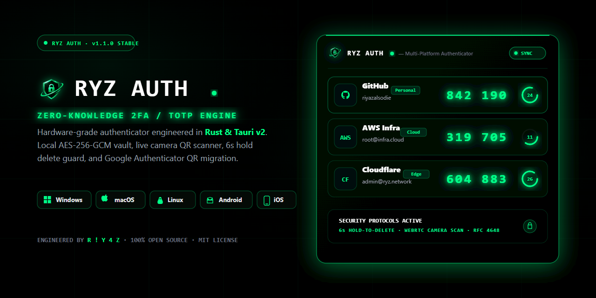

<div align="center">


# RYZ Authenticator

<p align="center">
  
</p>

**Open-Source, Zero-Knowledge 2FA & TOTP Authenticator for Windows, macOS, Linux, Android & iOS**  
*The lightweight, native Rust alternative to Authy Desktop, Google Authenticator, and 2FAS.*

[](https://github.com/riyazalsodie/RYZ-Authenticator/releases)
[](https://auth.riyazz.dev)
[](https://github.com/riyazalsodie/RYZ-Authenticator/stargazers)
[](https://github.com/riyazalsodie/RYZ-Authenticator/releases)
[](LICENSE)

[](https://www.rust-lang.org/)
[](https://v2.tauri.app/)
[](https://react.dev/)
[](https://www.typescriptlang.org/)
[]()

[**🌐 Official Website (auth.riyazz.dev)**](https://auth.riyazz.dev) • [**⬇ Download Latest Release**](https://github.com/riyazalsodie/RYZ-Authenticator/releases) • [**Why RYZ Auth?**](#-why-ryz-authenticator) • [**Comparison Table**](#-authenticator-comparison) • [**User Guide**](#-quick-start--user-guide) • [**Security & Performance**](#-security--engine-optimizations) • [**Build from Source**](#-building-from-source)

</div>

---

## ⚡ Why RYZ Authenticator?

Since **Twilio discontinued the Authy Desktop app**, millions of users and developers have been left without a clean, native desktop and mobile Two-Factor Authentication (2FA) app. Most alternatives either trap your TOTP seeds on a single phone, force you into heavy 300 MB Electron browsers, or lock your tokens inside proprietary cloud accounts.

**RYZ Authenticator** solves this with a native **Rust + Tauri 2.0** core:
- **Ultra-Lightweight:** Uses **~25–35 MB RAM** on desktop (`0.0%` idle CPU) and launches cold in **<400ms**.
- **True Cross-Platform:** Native builds for **Windows 10/11**, **macOS (Apple Silicon & Intel)**, **Linux**, **Android**, and **iOS**.
- **Zero-Knowledge Encryption:** Every secret is encrypted locally using **XChaCha20-Poly1305** and **Argon2id** (`m=64MB, t=3, p=4`). Plaintext Base32 seeds never enter WebView JavaScript memory or leave your device unencrypted.
- **Hardware Anti-Theft Binding:** Sessions are cryptographically bound to your hardware (**Windows DPAPI + Motherboard `MachineGuid`**, **macOS Secure Enclave**, **Android Keystore**). Stolen vault files cannot be decrypted on another machine.

---

## 📊 Authenticator Comparison

| Feature | **RYZ Authenticator** | Google Authenticator | Authy | Microsoft Authenticator | 2FAS | Ente Auth |
| :--- | :---: | :---: | :---: | :---: | :---: | :---: |
| **Native Desktop App (Win / Mac / Linux)** | ✅ **Native Rust** | ❌ No | ❌ Discontinued | ❌ No | ❌ Browser Ext Only | ⚠️ Electron |
| **Mobile App (Android & iOS)** | ✅ **Yes** | ✅ Yes | ✅ Yes | ✅ Yes | ✅ Yes | ✅ Yes |
| **Desktop RAM Usage** | **~25–35 MB** | N/A | ~280 MB (EOL) | N/A | N/A | ~220 MB |
| **Zero-Knowledge E2EE Cloud Sync** | ✅ **XChaCha20-Poly1305** | ❌ Tied to Google | ⚠️ Closed-Source | ❌ Tied to Microsoft | ✅ Drive / iCloud | ✅ Yes |
| **Offline Encrypted File Backups** | ✅ **`.ryzbackup` File** | ❌ QR Export Only | ❌ No Local Export | ❌ No Local Export | ✅ Yes | ✅ Yes |
| **Live Camera + Screenshot QR Scan** | ✅ **Webcam, Phone & File** | ⚠️ Phone Camera Only | ⚠️ Phone Camera Only | ⚠️ Phone Camera Only | ⚠️ Phone Camera Only | ⚠️ Phone / File |
| **Google Authenticator Batch Import** | ✅ **`otpauth-migration://`** | ✅ Export Only | ❌ No | ❌ No | ✅ Yes | ✅ Yes |
| **Auto-Clear System Clipboard** | ✅ **Configurable (10s–60s)** | ❌ No | ❌ No | ❌ No | ⚠️ Mobile OS Only | ✅ Yes |
| **Hardware Anti-Theft Session Lock** | ✅ **DPAPI + MachineGuid** | ❌ No | ❌ No | ❌ No | ❌ No | ❌ No |
| **100% Open Source (MIT)** | ✅ **Yes** | ❌ Proprietary | ❌ Proprietary | ❌ Proprietary | ✅ Yes | ✅ Yes |

---

## 🧭 Quick Start & User Guide

### 1. Adding 2FA Accounts
Click **+ Add Account** in the header:
- **Live Camera QR Scanner (Phone, iOS, Windows, Webcam):** Open the **Scan QR / Image** tab and click **Open Camera Scanner**. Scan any TOTP QR code live using your phone camera or desktop webcam, and switch between front/rear lenses or multiple webcams with one tap.
- **Upload QR Screenshot or Take Photo:** Upload any QR screenshot from your PC/phone gallery or click **Take QR Photo with System Camera**.
- **1-Step Google Authenticator Migration:** Export your accounts from Google Authenticator as a single QR code, scan or upload it into RYZ Auth, and all accounts are decoded and imported automatically (`otpauth-migration://offline?data=...`).
- **Manual Base32 Entry & 30+ Service Presets:** Paste your RFC 4648 Base32 secret key or `otpauth://` URI. Includes live Base32 validation, typo detection (`0` vs `O`, `1` vs `I`), configurable algorithms (`SHA-1`, `SHA-256`, `SHA-512`), `6` or `8` digits, `30s` or `60s` periods, and **30+ built-in brand icons** (Rockstar Games, GitHub, Google, Steam, Discord, Binance, AWS, Cloudflare, Microsoft, Telegram, and more).

### 2. Copying Codes & Auto-Clear Clipboard
- **1-Tap Copy:** Click or tap any OTP code to copy it to your clipboard with instant visual confirmation.
- **Automatic Clipboard Wipe:** RYZ Auth automatically clears copied 2FA codes from your system clipboard after **10, 30, or 60 seconds** (configurable in **Settings**) so background clipboard monitors cannot steal your tokens.

### 3. Organizing with Groups, Search & Favorites
- **Instant Search:** Filter accounts by service name, username/email, or group tag in real time.
- **Favorites & Groups:** Pin high-priority accounts to **Favorites**, or organize them into *Personal*, *Work*, *Crypto*, *Banking*, *Gaming*, or custom groups.

### 4. Encrypted Backups & Multi-Device Cloud Sync
- **Offline Encrypted Backups (`.ryzbackup`):** Export your entire vault from **Settings → Encrypted Vault Backup & Restore**. Backup files are encrypted with **XChaCha20-Poly1305** and **Argon2id**—zero plaintext secrets ever touch your disk.
- **Real-Time Zero-Knowledge Sync:** Sign in to automatically sync your encrypted vault across your desktop and mobile devices with automatic offline fallback.

---

## 🛡️ Security & Engine Optimizations

- **Zero Plaintext Secrets in WebView RAM:** Base32 secrets are decrypted exclusively inside Rust's native memory enclave during RFC 6238 / RFC 4226 HMAC computation and immediately wiped via `zeroize` and `ZeroizeOnDrop`. The React UI only receives transient 6/8-digit display codes.
- **Hardware-Bound Session Encryption:**
  - **Windows:** Wraps session state with **Windows DPAPI (`CryptProtectData`)** + motherboard `MachineGuid` + Windows Hello biometric/PIN unlock.
  - **macOS / Linux / Android / iOS:** Binds local session keys to hardware/OS identifiers with XChaCha20-Poly1305.
- **Persistent Brute-Force Protection:**
  - Tracks failed authentication attempts on disk (`ryz_lockout_policy.bin`) so restarting the process cannot reset lockout timers.
  - Enforces exponential backoff (`30s` → `60s` → `120s` → `300s`) after 5 failed attempts and a `600ms` submission debounce.
- **Debounced Search & Rate-Limited Cloud Sync:**
  - `200ms` debounced search and `900ms` debounced cloud sync with a sliding-window rate limiter (max 8 syncs/min) keep network and CPU usage near zero.
- **Inactivity Auto-Lock & System Tray:**
  - Automatically locks the vault and purges master keys from RAM after **1, 5, 15, or 30 minutes** of inactivity.
  - Full desktop system tray integration (`Open RYZ Auth`, `Lock Vault`, `Exit`, minimize-to-tray, close-to-tray, and launch on OS startup).

---

## 📦 Downloads

Grab the latest pre-built installer for your platform from [**GitHub Releases**](https://github.com/riyazalsodie/RYZ-Authenticator/releases):

| Platform | Architecture | Format |
| :--- | :--- | :--- |
| **Windows 10 / 11** | `x64` | `.exe` (NSIS Installer) & `.msi` |
| **Android** | `ARM64` / `Universal` | `.apk` |
| **macOS** | `Apple Silicon` & `Intel` (`Universal`) | `.dmg` & `.app` |
| **Linux** | `x86_64` | `.deb` & `.AppImage` |

---

## 🔧 Building from Source

### Prerequisites
- **Node.js** `18+` & **npm**
- **Rust** `1.80+` (`rustup`)
- **Platform Build Tools:**
  - **Windows:** Visual Studio C++ Build Tools + Windows 10/11 SDK
  - **macOS:** Xcode Command Line Tools (`xcode-select --install`)
  - **Linux:** `sudo apt-get install -y libwebkit2gtk-4.1-dev libappindicator3-dev librsvg2-dev patchelf`
  - **Android:** Android SDK + NDK

### Build Commands
```bash
# 1. Clone the repository & install dependencies
git clone https://github.com/riyazalsodie/RYZ-Authenticator.git
cd RYZ-Authenticator
npm install

# 2. Start development mode
npm run tauri dev

# 3. Build native desktop installer (Windows / macOS / Linux)
npm run tauri build

# 4. Build Android release APK
npx tauri android build --apk --target aarch64
```

---

## 🔍 Keywords & Topics

`2fa` · `totp` · `hotp` · `authenticator` · `authy-alternative` · `google-authenticator` · `rust` · `tauri` · `zero-knowledge` · `xchacha20-poly1305` · `argon2id` · `password-manager` · `security` · `cryptography` · `windows-dpapi` · `cross-platform` · `desktop-authenticator`

---

## 📄 License

Licensed under the [**MIT License**](LICENSE) © **R ! Y 4 Z**.

---

<div align="center">
Built by <b>R ! Y 4 Z</b> · If you find RYZ Authenticator useful, consider giving the repo a ⭐ on <a href="https://github.com/riyazalsodie/RYZ-Authenticator">GitHub</a>!
</div>
